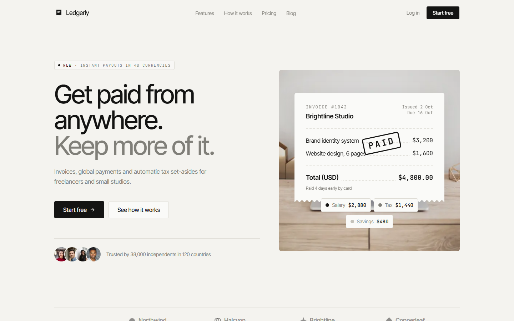
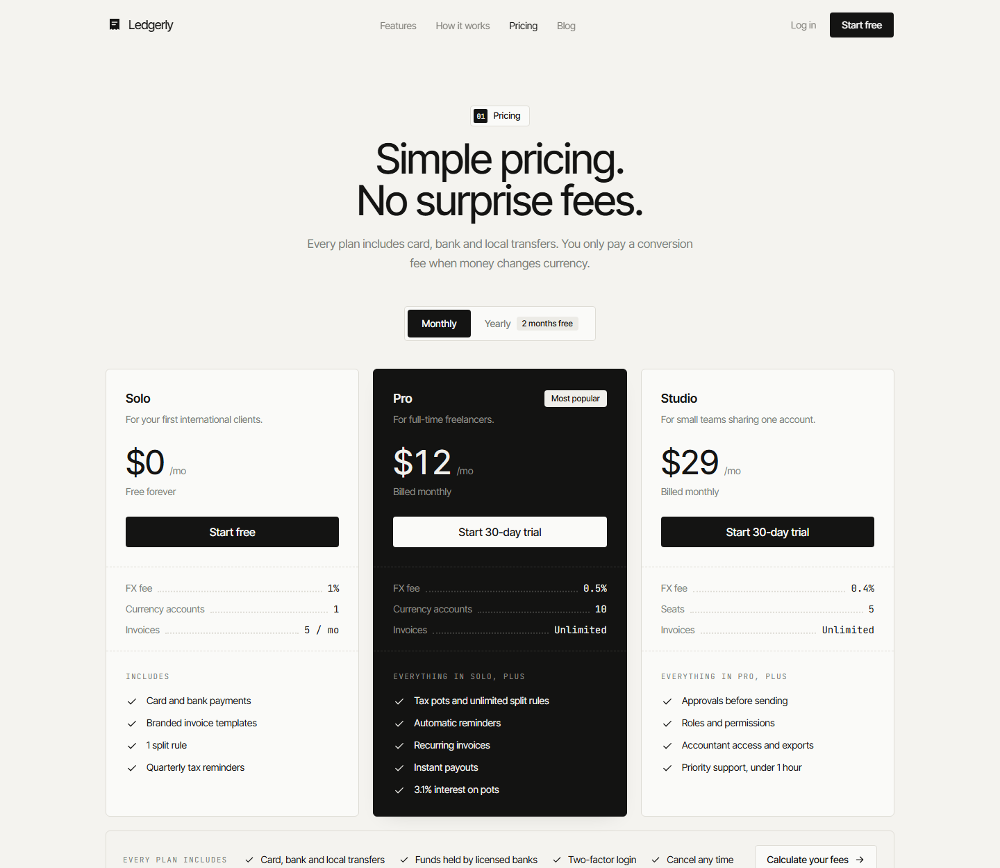
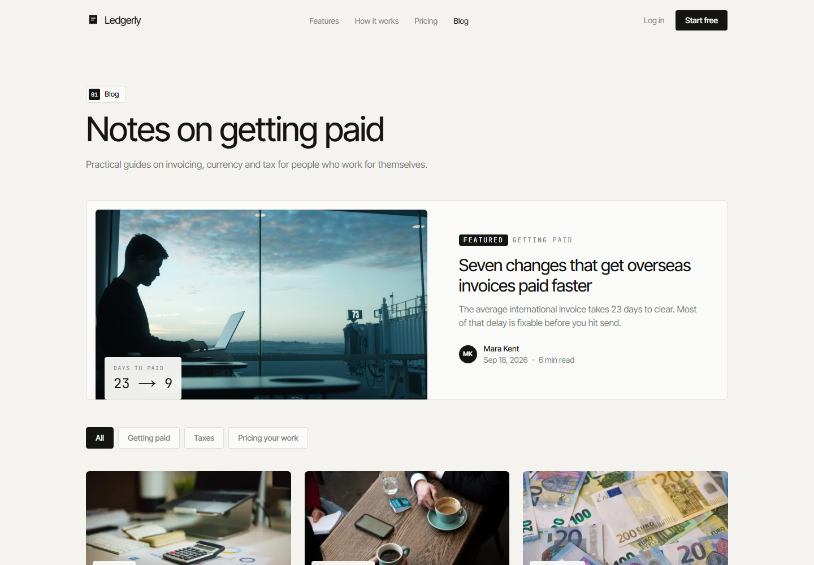

<div align="center">


# Ledgerly

**Get paid from anywhere. Keep more of it.**

A marketing site for a fictional fintech product that helps freelancers and small studios send invoices,<br />
get paid in 40+ currencies, and split every payment into Salary, Tax and Savings automatically.

[**Live site →**](https://ledgerly-rouge-three.vercel.app)

<br />


<br />



</div>

<br />

## Highlights

- **Interactive payment split.** Drag an incoming payment from $500 to $20,000, switch currency, and edit the Salary / Tax / Savings percentages. They always add up to exactly 100%, and the amounts are allocated to the cent.
- **Receipt-style visual language.** Zig-zag receipt cards, dotted leader lines, mono figures and an animated rubber-stamp "PAID", used from the hero through to the 404 page.
- **Calm, minimal design system.** Warm "ledger paper" neutrals, two-tone headlines and hairline dividers, all driven by CSS variables so the theme can be swapped in one file.
- **Real content, not lorem ipsum.** Six blog posts, two legal pages, FAQs, plans and testimonials, all stored as typed data in `lib/`.
- **Built for everyone.** Keyboard-operable tabs and accordions, visible focus states, one `h1` per page, and full `prefers-reduced-motion` support: animations show their final state, and the marquee and carousel turn into static grids.

<br />

## Pages

| Route | What's there |
| --- | --- |
| `/` | Hero, logo marquee, problem stats, payment split, how it works, feature tabs, audiences, testimonials, security, pricing, blog, FAQ, call to action |
| `/pricing` | Plan cards with a monthly / yearly toggle, a grouped comparison table and a fee calculator |
| `/contact` | Validated contact form with a receipt-style success state, plus support cards |
| `/blog`, `/blog/[slug]` | Featured post, category filters, article pages with related posts and per-post metadata |
| `/legal/[slug]` | Privacy policy and terms of service |
| `404` | "This page never got paid." A receipt stamped `404 · UNPAID` |

<table>
  <tr>
    <td width="50%"></td>
    <td width="50%"></td>
  </tr>
  <tr>
    <td align="center"><sub>Pricing</sub></td>
    <td align="center"><sub>Blog</sub></td>
  </tr>
</table>

<br />

## Tech stack

| | |
| --- | --- |
| **Framework** | [Next.js 15](https://nextjs.org) (App Router, static generation) |
| **Language** | TypeScript |
| **Styling** | Tailwind CSS 3 with CSS-variable design tokens |
| **Animation** | Framer Motion |
| **Fonts** | Inter Tight and JetBrains Mono via `next/font` |
| **Images** | `next/image` with photography from [Unsplash](https://unsplash.com) |
| **Hosting** | [Vercel](https://vercel.com) |

No backend: forms validate and confirm on the client only.

<br />

## Getting started

Requires Node.js 18.18 or newer.

```bash
git clone https://github.com/<your-username>/ledgerly.git
cd ledgerly
npm install
npm run dev
```

Then open [http://localhost:3000](http://localhost:3000).

| Script | |
| --- | --- |
| `npm run dev` | Start the development server |
| `npm run build` | Create a production build |
| `npm run start` | Serve the production build |

<br />

## Project structure

```
app/                  Routes, layout, metadata, sitemap, 404
components/
  sections/           Landing page sections (Hero, PaymentSplit, Pricing…)
  ui/                 Reusable pieces (Button, ReceiptCard, LineItem, PlanCard, Tabs…)
  pricing/            Plan grid, comparison table, fee calculator
  blog/               Post cards, post body renderer, index with filters
  contact/            Contact form
  layout/             Navbar and footer
lib/                  All copy and data: site, plans, posts, FAQs, testimonials, legal, images
docs/                 Screenshots for this README
```

<br />

## Customising

**Copy and data.** Every headline, price, FAQ and post lives in `lib/`, never hard-coded in components.

| File | Contents |
| --- | --- |
| `lib/site.ts` | Navigation, hero, section copy, contact page, 404 |
| `lib/plans.ts` | Plans, comparison table, fee calculator |
| `lib/posts.ts` | Blog posts with structured body content |
| `lib/faqs.ts`, `lib/testimonials.ts`, `lib/legal.ts` | FAQs, customer quotes, legal pages |
| `lib/images.ts` | Photo IDs and photographer credits |

**Design tokens.** Colours, fonts, radii, shadows and spacing are CSS variables at the top of `app/globals.css`; `tailwind.config.ts` only points at them. For example:

```css
:root {
  --color-bg: 244 243 239;      /* page background */
  --color-ink: 20 20 19;        /* text and primary buttons */
  --radius-pill: 4px;           /* set to 999px for round pills */
  --heading-weight: 450;
}
```

**Payment split component.** The interactive split is a standalone component you can reuse anywhere:

```tsx
<PaymentSplit
  defaultAmount={4800}
  splits={[
    { label: "Salary", percent: 60 },
    { label: "Tax", percent: 30 },
    { label: "Savings", percent: 10 },
  ]}
/>
```

**Site URL.** Metadata uses `NEXT_PUBLIC_SITE_URL` if set, otherwise Vercel's production URL, otherwise `http://localhost:3000`.

<br />

## Deploy

[](https://vercel.com/new)

Import the repository in Vercel. No environment variables are required.

<br />

## Credits

- Photography from [Unsplash](https://unsplash.com). Each photographer is listed in [`RESEARCH.md`](RESEARCH.md#photo-credits).
- Layout research and the patterns behind each section are documented in [`RESEARCH.md`](RESEARCH.md).

> **Note:** Ledgerly is a fictional product. Company names, customers, quotes and figures on the site are placeholders.

<br />

<div align="center">
<sub>Designed and built by Ahsan Habib.</sub>
</div>
